<div align="center">

```
$ whoami --contributions
```



```
$ whoami
```

<table>
<tr>
<td width="370" valign="top">

</td>
<td width="490" valign="top">

</td>
</tr>
</table>

<sub>Heatmap refreshed daily from real GitHub contribution data · built with Python + SVG, no external stats services</sub>

</div>

---

## What this is

A GitHub profile repository (`shreyanshmishra8899-lab/shreyanshmishra8899-lab`) that renders the
README above as a terminal-themed portfolio: an animated ASCII portrait, a
neofetch-style info card, and a real, auto-refreshing contribution heatmap.
Every number shown comes from this GitHub account's actual public
contribution data -- nothing is fabricated, and a failed data fetch never
silently replaces good data with bad (see "Data integrity guarantees" below).

## Repository layout

```
.
├── README.md
├── avi-ascii.svg              # animated ASCII portrait (generated, committed)
├── info-card.svg              # animated neofetch-style card (generated, committed)
├── contrib-heatmap.svg        # animated contribution heatmap (generated, committed)
├── data/contributions.json    # raw + derived contribution data (generated, committed)
├── source-prepped.png         # intermediate photo output (git-ignored, local only)
├── scripts/
│   ├── profile_config.py      # single source of truth for name/role/stack
│   ├── prep_photo.py          # photo -> background-removed, enhanced PNG
│   ├── make_ascii_svg.py      # prepped PNG -> animated ASCII SVG
│   ├── make_info_card.py      # profile_config.py -> animated info card SVG
│   ├── fetch_contributions.py # GitHub -> data/contributions.json
│   ├── render_heatmap_svg.py  # data/contributions.json -> heatmap SVG
│   └── requirements.txt
├── tests/                     # pytest unit tests (parsing, streaks, SVG XML validity)
└── .github/workflows/update-profile-art.yml   # daily heatmap refresh
```

## How the pieces fit together

| Asset | Generator | Inputs | Refreshed by |
|---|---|---|---|
| `contrib-heatmap.svg` | `render_heatmap_svg.py` | `data/contributions.json` | Daily GitHub Actions workflow |
| `data/contributions.json` | `fetch_contributions.py` | GitHub's public contributions page (or GraphQL, if a token is set) | Daily GitHub Actions workflow |
| `avi-ascii.svg` | `make_ascii_svg.py` | `source-prepped.png` | Manually, when the photo changes |
| `source-prepped.png` | `prep_photo.py` | a local photo (never committed) | Manually, when the photo changes |
| `info-card.svg` | `make_info_card.py` | `scripts/profile_config.py` | Manually, when profile details change |

The photo pipeline (`prep_photo.py`, `make_ascii_svg.py`) and its
dependencies (`rembg`, `opencv-python-headless`, `onnxruntime`) are
deliberately **not** part of the daily workflow -- it only ever touches the
contribution data and the heatmap SVG.

## Setup

```bash
git clone https://github.com/shreyanshmishra8899-lab/shreyanshmishra8899-lab.git
cd shreyanshmishra8899-lab
python -m venv .venv
source .venv/bin/activate        # Windows: .venv\Scripts\activate
pip install -r scripts/requirements.txt
```

Optional: copy `.env.example` to `.env` and adjust `PROFILE_*` values to
re-point the whole profile (name, status line, experience line) at a
different account without touching code. None of these values are secret.

## Regenerating assets locally

**Contribution heatmap** (safe to run anytime, no local photo needed):

```bash
python scripts/fetch_contributions.py
python scripts/render_heatmap_svg.py
```

**ASCII portrait** (run once per new photo; requires `rembg`/`opencv`):

```bash
python scripts/prep_photo.py "/path/to/photo.jpg" --out source-prepped.png --width 900
python scripts/make_ascii_svg.py --columns 100
```

The first run of `prep_photo.py` downloads an ONNX segmentation model
(`u2net_human_seg`, ~175MB) to `~/.u2net`. If that download fails (network,
proxy, disk space), `prep_photo.py` logs a warning and falls back to using
the original photo without background removal rather than crashing --
rerun it once the download can succeed, or pass `--no-bg-removal` to skip
that step intentionally.

**Info card** (after editing `scripts/profile_config.py`):

```bash
python scripts/make_info_card.py
STATIC=1 python scripts/make_info_card.py --out info-card-static-preview.svg   # no animation, for quick previews
```

## Data integrity guarantees

- `fetch_contributions.py` validates GitHub's response (enough day cells
  found, `data-level` attributes present, HTTP status) before writing
  anything. On any validation failure it logs the problem and exits
  non-zero **without touching the previously saved `data/contributions.json`**.
- `render_heatmap_svg.py` refuses to render if the data file is missing or
  has implausibly few days, rather than drawing a misleading partial graph.
- Streaks, totals, and the "best day" are computed directly from the saved
  per-day counts -- nothing is estimated or interpolated.
- If GitHub blocks anonymous scraping or changes the contributions page's
  HTML, the anonymous path will raise a clear error naming what changed.
  Set a repository secret `GH_CONTRIB_TOKEN` (any PAT; no special scopes
  needed, just public read access) to switch to the authenticated GraphQL
  API instead, which is more stable across GitHub frontend changes. No
  token is required for normal operation, and none is ever written to disk
  or committed -- `.env`/`.env.example` only hold non-secret display
  settings.

## GitHub Actions automation

`.github/workflows/update-profile-art.yml`:

- Runs daily at `06:17 UTC` via `cron: "17 6 * * *"`, plus `workflow_dispatch`
  for manual runs.
- Installs only `requests` + `beautifulsoup4` (not the full
  `scripts/requirements.txt`, which also includes the heavy photo-pipeline
  dependencies this workflow never uses).
- Grants itself only `contents: write`, and only at the job level.
- Commits `data/contributions.json` and `contrib-heatmap.svg` **only if
  they actually changed**; otherwise it exits without a commit.
- Cannot loop: it has no `push` trigger, so its own commit to the default
  branch can't re-trigger it (the `github.actor != 'github-actions[bot]'`
  guard is extra defense-in-depth, not the primary safeguard).

**Known limitations to be aware of:**

- GitHub's `schedule` trigger is best-effort and commonly delayed by
  several minutes to over an hour during high platform load -- don't
  expect the commit at exactly 06:17 UTC.
- The anonymous contributions page can rate-limit or block scraping from
  shared IP ranges (including, occasionally, GitHub Actions runners
  themselves). If the scheduled run starts failing, add `GH_CONTRIB_TOKEN`
  as described above.
- Scheduled workflows only run from the **default branch** of the
  repository on GitHub. If you rename or change the default branch, make
  sure this workflow file still exists there afterward.

## Animation notes

Animations use CSS `@keyframes` inside each SVG's own `<style>` block
(no `<script>`, no external CSS) so they survive GitHub's sanitization of
user content. Even so, some renderers (certain Markdown clients, some
RSS/feed readers, `` caching proxies) strip or freeze SVG animation
entirely -- every SVG here is designed to also look complete and correct as
a static image, and respects `prefers-reduced-motion`.

## Testing

```bash
pip install -r scripts/requirements.txt   # includes pytest
pytest tests/ -v
```

Tests cover: contribution HTML parsing (valid + malformed pages), streak
and monthly-total calculations, heatmap week/month-label grid alignment,
and SVG well-formedness (XML parse + XML-escaping of injected text) for
all three generated SVGs.

## Troubleshooting

| Symptom | Likely cause / fix |
|---|---|
| `fetch_contributions.py` exits 1 with "only found N day cells" | GitHub changed the contributions page markup. Check the error message, update the selector in `parse_html()`, or set `GH_CONTRIB_TOKEN` to use the GraphQL fallback instead. |
| `fetch_contributions.py` exits 1 with HTTP 429 | Anonymous rate limit. Wait, or set `GH_CONTRIB_TOKEN`. |
| `prep_photo.py` warns "Background removal failed" | Model download was interrupted. Re-run it (resumes/retries), check network/proxy settings, or pass `--no-bg-removal`. |
| Heatmap/info card look unchanged after editing `profile_config.py` | You edited the file but didn't re-run `make_info_card.py` / `render_heatmap_svg.py`. |
| Workflow runs but doesn't commit | Normal -- it only commits when `data/contributions.json` or `contrib-heatmap.svg` actually changed since the last run. |
| Workflow doesn't run on schedule at all | Confirm the workflow file is present on the repository's actual default branch on GitHub, and that the repo has had at least one Actions run in the last 60 days (GitHub disables schedules on fully inactive repos). |

## Configuration reference

All user-facing text is centralized in `scripts/profile_config.py`
(overridable via the environment variables listed in `.env.example`):
GitHub username, display name, current status line, previous-experience
line, and the categorized tech stack shown on the info card. No project
names, metrics, or achievements are listed because none were supplied;
add them to `ProfileConfig.highlights` in `scripts/profile_config.py` once
available -- the info card only renders that section when it's non-empty.
